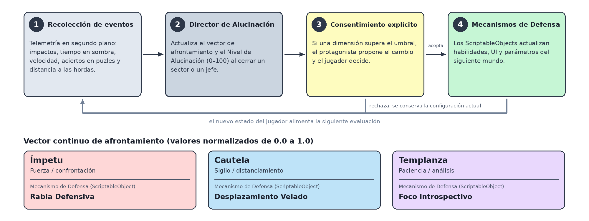
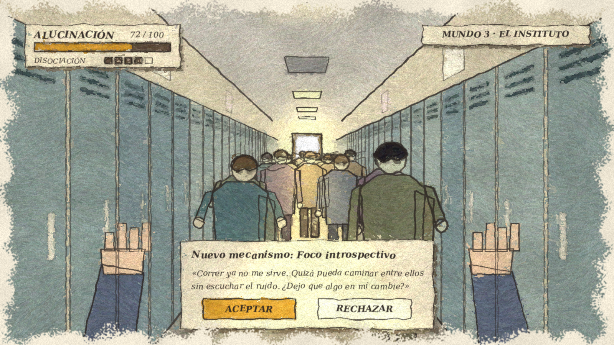

# 🎮 TFG: Videojuego Narrativo 2D en Primera Persona con Mecánicas Adaptativas

> **Grado en Ingeniería Multimedia — Universidad de Alicante (EPS UA)**  
> **Autor:** Leigh Garrett | **Tutores:** Carlos J. Villagrá Arnedo, Patricia María Compañ Rosique  
> **Estado:** En desarrollo

---

### 📖 Descripción General / Overview

**ES:**  
Este repositorio contiene la memoria académica (**LaTeX**) y el prototipo funcional (**Unity / C#**) de mi Trabajo Fin de Grado: *"Desarrollo de un videojuego narrativo en 2D con mecánicas adaptativas sobre la perspectiva de género"*.  

El proyecto plantea una experiencia en **primera persona 2D con sensación de profundidad (2.5D)** basada en *sprites* planos orientados a cámara (*billboards*) pintados a mano. La historia comienza bajo la falsa premisa de un apocalipsis zombi de supervivencia y atraviesa tres mundos (*Calles de Cuarentena*, *Laberinto Fracturado* e *Instituto y Azotea*) como metáfora del agotamiento psicológico derivado de la disforia de género y el rechazo social. A nivel técnico, incorpora un **Director de Alucinación** en segundo plano que evalúa el estilo del jugador en tres dimensiones continuas (*Ímpetu, Cautela y Templanza*) e inyecta **Mecanismos de Defensa** (habilidades e interfaz adaptativa) mediante `ScriptableObjects`, pidiendo siempre el **consentimiento explícito** del usuario.

**EN:**  
This repository contains the academic thesis (**LaTeX**) and prototype (**Unity / C#**) for my Bachelor's Thesis: *"Development of a 2D narrative videogame with adaptive mechanics on gender perspective"*.  

The project proposes a **first-person 2D experience with 2.5D depth** using hand-painted 2D *billboard* sprites. Starting under the false premise of a zombie survival game, the player traverses three shifting worlds that represent the psychological exhaustion caused by gender dysphoria and social rejection. Technically, it features a background **Hallucination Director** that evaluates player behavior across three continuous dimensions (*Impetus, Caution, and Temperance*) and injects **Defense Mechanisms** (adaptive abilities and UI) in real time via `ScriptableObjects` and an **explicit player consent** mechanic.

---

### 📂 Estructura del Repositorio / Repository Structure

- **[`docs/`](./docs):** Memoria académica y Documento de Diseño del Juego (GDD) en **LaTeX** (`pdflatex` + `biber`, normativa APA, plantilla oficial EPS UA).
- **[`game/`](./game):** Proyecto del prototipo en **Unity (C# / URP)** *(En fase de prototipado)*.

---

### 🛠️ Stack Tecnológico / Tech Stack

- **Motor y Programación:** Unity (URP Lighting, 2D Billboards en 1.ª persona, Canvas UI), C# (`ScriptableObjects`, Patrón Observador).
- **Documentación Académica:** LaTeX (`pdflatex` + `biber`, estilo APA).

---

### 🔄 Flujo del Sistema Adaptativo / Adaptive System Flow

  

### 🎨 Concepto Visual en Primera Persona (2.5D Billboards)

  

